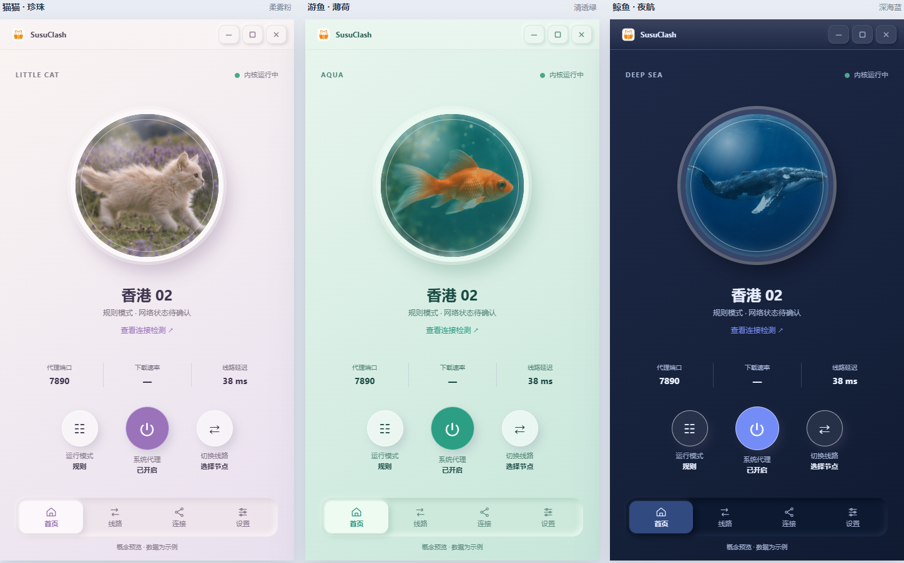
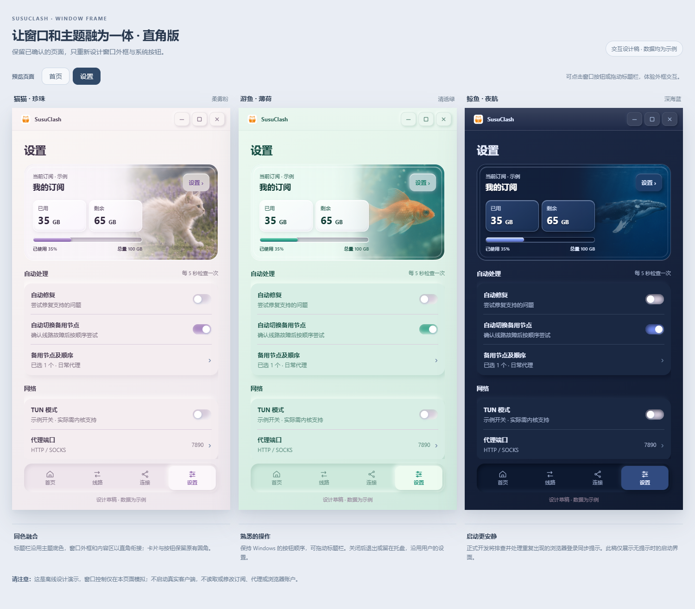
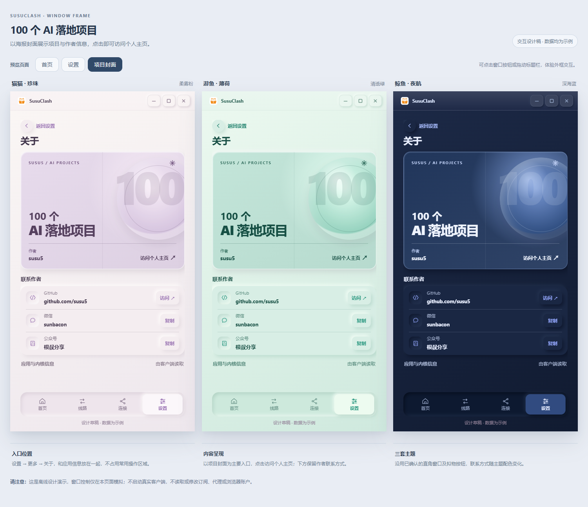

# SusuClash

**专注 Codex 网络问题，同时让代理和线路管理更简单。**

SusuClash 是一款基于 Mihomo 的 Windows 桌面代理客户端。它把常用的代理控制、订阅管理、线路选择和问题检测放在一个简洁的界面里，并重点提供 **Codex 网络连接专项检测与修复**。

项目目前处于测试阶段，欢迎体验、反馈问题和提出建议。

## 首页设计

首页集中展示当前线路、代理状态、端口、下载速率和延迟，可以快速切换运行模式、系统代理和线路，也可以进入连接检测。

## 专项解决 Codex 网络问题

当 Codex 无法连接时，问题可能出在本地代理端口、代理路径或网络环境。SusuClash 提供专项检查，帮助定位可识别的连接异常；对于符合条件的本地固定代理端口问题，可以先预览修复内容，再由用户确认执行。

- **检查连接路径**：结合本地代理配置、端口状态和站点响应进行判断。
- **修复前先预览**：仅在满足安全条件时提供端口修复，用户确认后才备份并更新配置。
- **修复后自行验证**：重新打开 Codex 并在应用中测试；站点有响应不等于 Codex 内的请求一定成功。

## 更多界面设计

SusuClash 提供珍珠猫猫、薄荷游鱼和夜航鲸鱼三套主题，搭配动态主题画面与拟物质感控件。

**窗口与设置页设计稿**

**作者页设计稿**

> 以上均为设计稿，图中的线路、订阅名称和用量均为示例；实际界面以运行版本为准。

## 主要功能

- **代理控制**：切换规则、全局和直连模式，按需开启或关闭系统代理。
- **订阅管理**：添加订阅、手动更新和启用配置，也支持导入本地 YAML 配置。订阅服务提供有效用量数据时，可查看已用与剩余流量。
- **线路与连接**：查看策略组、选择线路、测试延迟，并查看或关闭内核可见的当前连接。
- **问题检测**：每 5 秒检查一次基础运行状态，帮助发现网络、端口和内核方面的问题。
- **备用节点**：自行选择并排序备用节点；启用自动切换后，客户端会在确认线路故障时按顺序尝试。自动修复和自动切换分别由用户控制；目前自动修复主要尝试恢复内核。
- **Codex 网络专项检测与修复**：检查相关连接和本地代理端口，对符合条件的固定本机代理端口问题提供确认后修复。
- **个性化与便捷操作**：三套主题、系统托盘和可选的开机启动。

## 运行环境

- Windows x64
- Microsoft Edge WebView2 Runtime
- Mihomo 内核及运行所需的规则文件

项目仍在测试，运行依赖不包含在仓库中。请先阅读 [构建说明](BUILDING.md)，按需自行准备对应组件；当前仓库不提供已发布的安装包。

## 当前限制

- TUN 模式尚未接入；订阅和应用的自动更新功能尚未实现。
- 当前支持经过 Mihomo 校验的完整 YAML 配置，不支持包含远程 `proxy-providers` 或 `rule-providers` 的配置；其他格式及协议不能保证兼容。
- 自动检测和修复无法覆盖所有故障。遇到连接问题时，仍需结合具体应用和网络环境进行检查。
- 当前项目为测试版，不建议未经验证就将其作为现有稳定代理客户端的无缝替代品。

## 数据与隐私

订阅和应用数据保存在本机用户数据目录。订阅链接可能包含访问凭证，请勿公开分享链接、配置文件或日志。

## 作者

- 作者：**susu5**
- GitHub：[github.com/susu5](https://github.com/susu5)
- 个人主页：[susu5.cn](https://susu5.cn)
- 微信：**sunbacon**
- 公众号：**根叔分享**

个人主页还展示了作者的 **100 个 AI 落地项目**。

## 许可证

本项目代码采用 [GNU General Public License v3.0](LICENSE)（GPL-3.0-only）。第三方组件及其数据遵循各自的许可条款；运行依赖不包含在本仓库中，准备方式见 [构建说明](BUILDING.md)。
