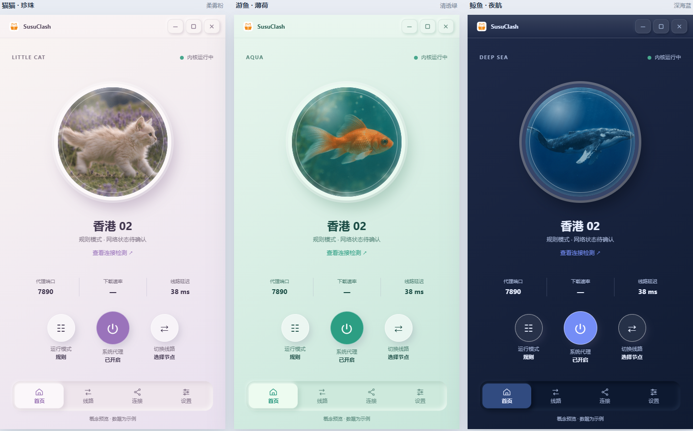

# SusuClash v0.1.24（预发布）

Windows x64 独立代理客户端，管理受控 Mihomo、订阅、线路和活动连接，并提供八项代理基础检查与 Netfix Codex 网络修复工具箱。

## 本版更新

从 v0.1.20 到本版，Codex 专项切换为 Netfix，增加系统代理恢复与文件保存保护，并更新 MSI 安装界面。v0.1.24 相对 v0.1.23 主要改动安装器，客户端与 Netfix 规则保持不变；v0.1.20 已有的连接应用归属识别继续保留。

- **Netfix 专项**：按代理链路配置、身份与额度、传输异常分层检查，展示证据、链路探测和操作记录。对符合条件的 Codex 已有 `.env` 本机 HTTP 代理配置，提供端口同步、只读锁定／解锁及已核验备份恢复。
- **写入保护**：每次修改先预览并确认，再核对内容、文件身份、权限和属性。Netfix 保留原文件格式，备份、替换并回读；失败按本次写入归属恢复，外部改动或恢复冲突保留现场。订阅索引与修复元数据也加强并发保护及 Windows 临时拒绝替换时的有界重试。
- **系统代理恢复**：协调启动恢复、手动操作、后台操作与专项写入，保护其他程序正在使用的代理；退出时等待处理安全收尾。
- **MSI 安装界面**：三主题、小猫动效、实际进度圆环、完整 GPL 阅读入口和放大的勾选控件。保留原升级系列、安装位置与数据目录，不自动重启电脑或关闭其他应用。

## 使用与边界

- 在 [GitHub Releases](https://github.com/susu5/SusuClash/releases) 选择标为 **Pre-release** 的 v0.1.24，下载 Windows x64 MSI。客户端的更新检查只查询正式发行版，不自动下载安装；预发布版本需自行选择。
- 从托盘正常退出旧版后安装。默认按当前用户安装到 `%LOCALAPPDATA%\Programs\ClashGlass`，需要 Microsoft Edge WebView2 Runtime。安装成功后，只有明确点击“完成”并保留打开选项才尝试启动应用；右上角关闭只关闭安装器。
- 添加有效订阅或导入完整 YAML 并启用，再管理模式、系统代理、线路和连接。系统代理、应用固定代理与直连按实际路径分别检查，未开启系统代理不自动表示故障。
- 从首页动物大圆进入代理综合检查，再打开 Codex 网络修复工具箱。进入专项自动进行只读诊断；写入需逐次预览确认，计划与现场变化后需重新检查。
- 当前专项不再执行旧版自动传输设置尝试、备用线路候选和独立 CLI 模型测试。兼容恢复器仅核对旧未完成事务，不继续旧策略。普通代理后台恢复／换线仍需分别启用，不属于 Netfix B/C 分支。
- Netfix 不自动换节点、重开 Codex、修改 provider 或重放原任务。登录和额度由本人处理；无认证 HTTP/TLS 探测有响应，不代表模型请求、WebSocket 长流或原会话恢复。当前专项不发送模型测试消息。
- TUN 尚未接入，不自动提升权限或关闭证书验证。远程 `proxy-providers`／`rule-providers` 暂不支持；没有完整的应用自动升级安装流程。

## 已知问题

安装结束后的结果与启动提示存在误判风险，尚未修复。辅助重启回执未确认时，界面可能显示结果未确认；ShellExecute 未返回进程句柄时，可能提示未能打开应用。这些提示不能单独作为重新安装的依据，请结合系统安装结果和托盘状态判断，并保留弹窗原文。没有原文与当时的返回值，不能认定每次弹窗都是同一原因。

安装包尚未数字签名。本版仍为试用性质的预发布版本，实际网络、账户和 Codex 原任务效果需在本人环境中验证。

## 数据与隐私

应用数据位于 `%LOCALAPPDATA%\ClashStandalone`，升级沿用，卸载不主动删除。订阅、配置和恢复记录可能含凭证，请勿上传整个数据目录。

Netfix 在本机读取有界日志与 `auth.json`，在内存解析认证到期时间；不展示、上传或记录 token，不刷新或改写认证。日志可能来自其他本机会话，不能单凭日志判定当前请求的根因。Netfix 备份保留在目标 `.env` 同目录，恢复记录与去敏审计留在本机。

## 开发

开发建议使用与安装包一致的 Node.js 24.22.1，运行 `pnpm install --frozen-lockfile`。正式构建按 `packaging/release-dependencies-v0.1.24.json` 固定依赖来源与哈希，具体入口及安装器依赖见 [BUILDING.md](BUILDING.md) 和 [第三方声明](THIRD_PARTY_NOTICES.md)。运行二进制和用户数据不包含在源码库中。

视觉规范为 [DESIGN.md](DESIGN.md) author-v3：小字 12px、卡片圆角 18px。运行 `npm run design:check` 和 `npm run test:design`；开发预览使用 `npm run preview:themes`，只使用隔离的内存示例数据。

功能源码、生产资源与本版 MSI 的对应关系见 [SOURCE-MAPPING.md](SOURCE-MAPPING.md)。公开文档已精简，不承诺整个仓库与 MSI 文档逐字节相同，也不承诺重新构建的 MSI 字节完全一致。

## 历史设计稿

`images/` 中以下三张图片保留自早期仓库，属于**历史设计稿，不是 v0.1.24 实际截图**；图中的线路、订阅和用量均为示例，旧字号或圆角不覆盖当前 author-v3 合同。当前有效参照见 [统一设计规范](DESIGN.md) 和 [批准参照图](design/reference/author-about-approved-v3.png)。

展开历史设计稿

## 作者与许可证

- 作者：**susu5**
- GitHub：[github.com/susu5](https://github.com/susu5)
- 个人主页：[susu5.cn](https://susu5.cn)
- 微信：**sunbacon**
- 公众号：**根叔分享**

项目源码采用 [GNU GPL v3.0](LICENSE)（GPL-3.0-only）。第三方组件、数据和安装器工具遵循各自许可，详见 [第三方声明](THIRD_PARTY_NOTICES.md)。
