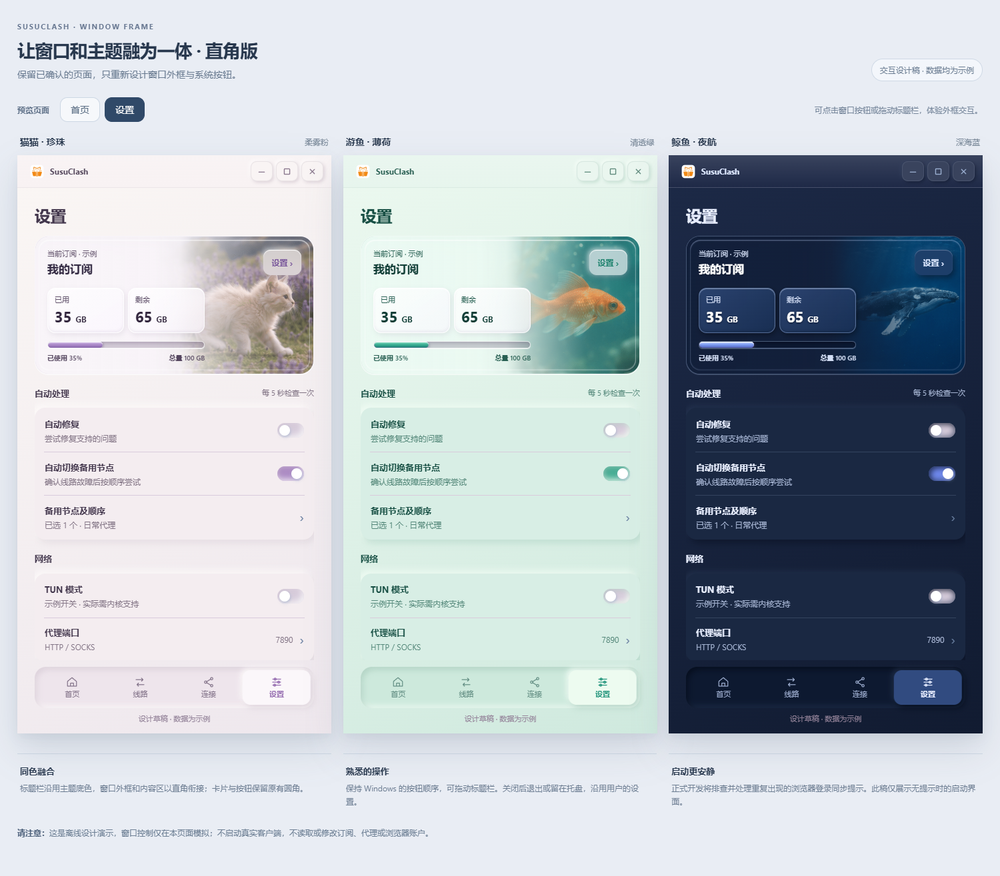
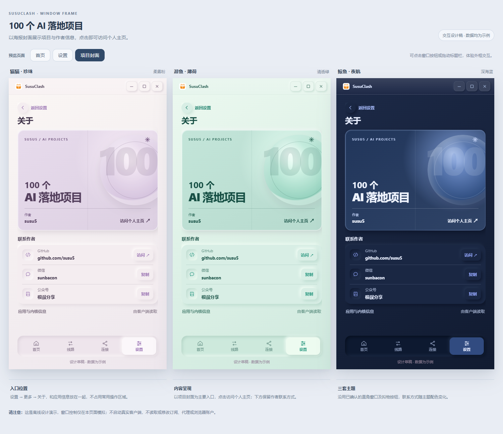

# SusuClash v0.1.26（预发布）

Windows x64 独立代理客户端，管理受控 Mihomo、订阅、线路和活动连接，并提供八项代理基础检查与 Netfix Codex 网络修复工具箱。

## 本版更新

v0.1.26 简化备用节点查找与顺序调整，并包含 v0.1.25 的启动修复。代理诊断、Netfix 规则和已确认的猫、鱼、鲸三主题继续保留。

- **找节点**：按名称或地区搜索，空格分隔多个关键词；直接勾选或明确批量选择搜索结果，最多64个。连续选择保留搜索、焦点与滚动位置。
- **调整顺序**：独立“已选顺序”页，直接上移、下移、移除，也保留拖动与键盘排序。清空、移除失效项先改草稿，保存后生效；保存失败保留草稿，退出未保存时提醒。
- **保护名单归属**：草稿绑定进入时的配置和策略组；编辑期间切换配置或组会阻止误保存。备用名单按配置ID与策略组名分别保存。
- **启动与恢复**：同一数据目录只启动一个客户端；重复打开通知已有窗口。内核和入口验证就绪后保存首次分配端口，后续复用；用户明确开启系统代理后记住选择，下次在就绪验证后恢复。外部代理和被其他程序占用的端口保留保护。

备用名单与顺序**不会自动增删、补选或按测速重排**。开启自动切换后，确认故障才按保存顺序验证候选并切换当前线路，不主动回切。订阅更新可以改变同名节点背后的服务器，自动策略组内部也可能自主选路；这些行为与改写备用名单不同。

## 使用与边界

- 在 [GitHub Releases](https://github.com/susu5/SusuClash/releases/tag/v0.1.26) 下载标为 **Pre-release** 的 Windows x64 MSI。客户端更新检查只查询正式发行版，不自动下载安装；预发布版本需自行选择。
- 从托盘正常退出旧版后安装。默认按当前用户安装到 `%LOCALAPPDATA%\Programs\ClashGlass`，需要 Microsoft Edge WebView2 Runtime。安装成功后，只有明确点击“完成”并保留打开选项才尝试启动应用；右上角关闭只关闭安装器。
- 添加有效订阅或导入完整 YAML 并启用，再管理模式、系统代理、线路和连接。系统代理、应用固定代理与直连按实际路径分别检查，未开启系统代理不自动表示故障。
- 初次升级没有系统代理开关记录时，请本人开启一次，之后才记忆。手动关闭代理或停核会清除自动开启意图；正常退出时恢复原系统状态。后台恢复和自动换线仍须分别启用。
- 进入设置中的备用节点页面，搜索、选择后到“已选顺序”调整并保存。当前线路在切换时跳过；失效项保留提示，不自动替换。清空并保存名单会关闭自动切换，其开关仍为全局保存。
- 从首页动物大圆进入代理综合检查，再打开 Codex 网络修复工具箱。Netfix 先进行只读诊断，按链路配置、身份额度与传输异常展示证据。符合条件的已有 Codex `.env` 本机 HTTP 代理支持端口同步、只读锁定／解锁与已核验备份恢复；每次写入需预览确认。
- Netfix 不自动换节点、重开 Codex、修改 provider 或重放原任务。登录和额度由本人处理；无认证 HTTP/TLS 探测有响应，不代表模型请求、WebSocket 长流或原会话恢复。当前专项不发送模型测试消息。兼容恢复器仅核对旧未完成事务，不继续旧版自动策略。
- TUN 尚未接入，不自动提升权限或关闭证书验证。远程 `proxy-providers`／`rule-providers` 暂不支持；没有完整的应用自动升级安装流程。

## 已知问题

安装结束后的结果与启动提示仍有误判风险，本版没有修改这些判定逻辑。辅助重启回执未确认时，界面可能显示结果未确认；ShellExecute 未返回进程句柄时，可能提示未能打开应用。请结合系统安装结果和托盘状态判断，并保留弹窗原文；这些提示不能单独作为重新安装的依据。

安装包尚未数字签名。本版为试用性质的预发布版本，实际升级、网络、账户和 Codex 原任务效果需在本人环境中验证。不能把这次启动改动描述为已查明所有历史内核退出的原因。

## 数据与隐私

应用数据位于 `%LOCALAPPDATA%\ClashStandalone`，升级沿用，卸载不主动删除。订阅、配置和恢复记录可能含凭证，请勿上传整个数据目录。

Netfix 在本机读取有界日志与 `auth.json`，在内存解析认证到期时间；不展示、上传或记录 token，不刷新或改写认证。日志可能来自其他本机会话，不能单凭日志判定当前请求的根因。Netfix 备份保留在目标 `.env` 同目录，恢复记录与去敏审计留在本机。启动失败只保留固定摘要，不记录原始内核输出或订阅凭据。

## 开发与验证

开发建议使用与安装包一致的 Node.js 24.22.1，运行 `pnpm install --frozen-lockfile --ignore-scripts`。正式构建按 `packaging/release-dependencies-v0.1.26.json` 固定依赖来源与哈希，具体入口及安装器依赖见 [BUILDING.md](BUILDING.md) 和 [第三方声明](THIRD_PARTY_NOTICES.md)。运行二进制和用户数据不包含在源码库中。

视觉规范为 [DESIGN.md](DESIGN.md) author-v3：小字12px、卡片圆角18px。运行 `npm run design:check` 和 `npm run test:design`；开发预览使用 `npm run preview:themes`，只使用隔离的内存示例数据。

本版冻结源码完整复测414项：411通过、0失败、3项条件跳过；另核对342个MSI载荷文件和38项安装消息模型。备用编辑器、包内运行及三主题两尺寸交互均做了隔离检查；这些检查不代替真实用户安装和网络验证。具体范围、安装组件复用和源码对应关系见 [SOURCE-MAPPING.md](SOURCE-MAPPING.md)。公开文档已精简，不承诺整个仓库与MSI文档逐字节相同，也不承诺重新构建的MSI字节完全一致。

## 历史设计稿

`images/` 中以下三张图片保留自早期仓库，属于**历史设计稿，不是 v0.1.26 实际截图**；图中的线路、订阅和用量均为示例，旧字号或圆角不覆盖当前 author-v3 合同。当前有效参照见 [统一设计规范](DESIGN.md) 和 [批准参照图](design/reference/author-about-approved-v3.png)。

展开历史设计稿

## 作者与许可证

- 作者：**susu5**
- GitHub：[github.com/susu5](https://github.com/susu5)
- 个人主页：[susu5.cn](https://susu5.cn)
- 微信：**sunbacon**
- 公众号：**根叔分享**

项目源码采用 [GNU GPL v3.0](LICENSE)（GPL-3.0-only）。第三方组件、数据和安装器工具遵循各自许可，详见 [第三方声明](THIRD_PARTY_NOTICES.md)。
